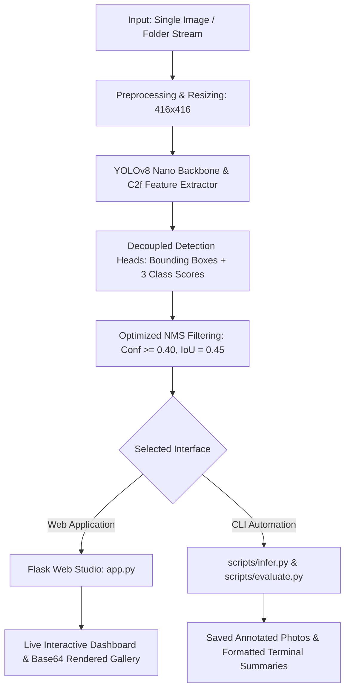

# 😷 AI Face Mask Detection & Compliance Monitoring Studio

[](https://www.python.org/)
[](https://docs.ultralytics.com/)
[](https://pytorch.org/)
[](http://127.0.0.1:5000)
[]()
[]()

An end-to-end computer vision solution engineered for real-time face mask detection, improper mask wearing identification, and zero-compliance tracking. Built with **Ultralytics YOLOv8 Nano**, optimized for **fast CPU inference (30+ FPS)** without requiring GPU hardware, and packaged with a modern, glassmorphic **Web Application Studio** and robust **CLI automation pipelines**.

---

## 📑 Table of Contents

- [1. Problem Statement & Classes](#1-problem-statement--classes)
- [2. System Architecture](#2-system-architecture)
- [3. Key Features](#3-key-features)
- [4. Dataset & Class Distribution](#4-dataset--class-distribution)
- [5. Model Performance & Benchmark Results](#5-model-performance--benchmark-results)
- [6. Project Directory Structure](#6-project-directory-structure)
- [7. Installation & Quick Start](#7-installation--quick-start)
- [8. Execution Methods](#8-execution-methods)
  - [Method 1: Interactive Web Studio (Recommended)](#method-1-interactive-web-studio-recommended)
  - [Method 2: Command-Line Single Image Inference](#method-2-command-line-single-image-inference)
  - [Method 3: Command-Line Batch Directory Inference](#method-3-command-line-batch-directory-inference)
  - [Method 4: Model Evaluation & Benchmarking](#method-4-model-evaluation--benchmarking)
  - [Method 5: Model Training & Retraining](#method-5-model-training--retraining)
- [9. Recommended Tuning & Deployment Policies](#9-recommended-tuning--deployment-policies)
- [10. Tech Stack & Dependencies](#10-tech-stack--dependencies)
- [11. Troubleshooting & FAQs](#11-troubleshooting--faqs)

---

## 1. Problem Statement & Classes

Monitoring face mask compliance across high-density facilities (transit hubs, schools, hospitals, offices) requires automated, low-latency detection that differentiates between **correct mask wearing**, **partial/faulty compliance**, and **complete non-compliance**.

This system identifies and classifies faces into three distinct categories:

| Class ID | Compliance Status | Visual Color Tag | Description & Criteria |
|:---:|:---|:---:|:---|
| **`0`** | **Wearing Mask** | 🟢 **Green** | **Full Compliance:** Surgical, N95, or cloth mask properly covering the mouth, chin, and nose bridge. |
| **`1`** | **Wore Mask Incorrectly** | 🟡 **Amber / Gold** | **Partial Compliance:** Mask is present but pulled below the nostrils, dangling from one ear, or resting under the chin. |
| **`2`** | **No Mask** | 🔴 **Crimson Red** | **Zero Compliance:** Face is completely bare and exposed with no mask protection. |

---

## 2. System Architecture

The pipeline processes input images through preprocessing, YOLOv8 feature extraction, tuned Non-Maximum Suppression (NMS), and dual interface consumers (Web Studio or CLI):



---

## 3. Key Features

- **🚀 Real-Time CPU Latency:** ~25–35 ms per frame (30–40 FPS throughput) on standard 12th Gen Intel Core i5 laptop CPUs.
- **🎨 Modern Dark Web UI Studio:** Full-featured single-page interface with glassmorphic styling, real-time metrics cards, drag-and-drop file uploads, and native folder selection.
- **📁 Dual Mode Uploads:** Process individual high-resolution photos or batch-process entire image directories at once.
- **🎛️ Dynamic Parameter Sliders:** Tune **Confidence Threshold (`conf`)** and **Intersection-over-Union (`iou`)** in real-time to eliminate phantom detections and box clutter.
- **🖼️ Aesthetic HUD Annotations:** Custom OpenCV rendering with corner bracket accents, class tags with confidence percentages, and top summary banners.
- **📊 Quantitative Audit Logging:** Aggregates total faces, compliance breakdowns, and average inference latency per batch.
- **🔬 Comprehensive CLI Suite:** Dedicated modular scripts for training, evaluation on test splits, and automated batch inferences.

---

## 4. Dataset & Class Distribution

The model is trained on a verified dataset in standard YOLO normalized format (`class_id x_center y_center width height`):

| Split | Images | Total Face Annotations | Wearing Mask (0) | Wore Mask Incorrectly (1) | No Mask (2) |
|---|:---:|:---:|:---:|:---:|:---:|
| **Train** | 2,776 | 4,507 | 2,682 (59.5%) | 162 (3.6%) | 1,663 (36.9%) |
| **Validation** | 805 | 1,252 | 693 (55.4%) | 52 (4.2%) | 507 (40.5%) |
| **Test (Held-out)** | 75 | 163 | 138 (84.7%) | 13 (8.0%) | 12 (7.4%) |
| **Total** | **3,656** | **5,922** | **3,513 (59.3%)** | **227 (3.8%)** | **2,182 (36.9%)** |

> **⚠️ Note on Class Imbalance:** Class 1 (*Wore Mask Incorrectly*) constitutes only **3.8%** of total annotations in the dataset. Detecting partial mask coverage represents an inherently difficult challenge compared to distinguishing clear masked vs unmasked faces.

---

## 5. Model Performance & Benchmark Results

### Validation Split Benchmark (805 Images, 1,252 Faces)

| Metric | Quick Prototype (3 Epochs) | Baseline Model (10 Epochs, `best.pt`) | Delta Improvement |
|---|:---:|:---:|:---:|
| **Overall Precision** | 61.0% | **79.5%** | **+18.5%** |
| **Overall Recall** | 62.3% | **65.5%** | **+3.2%** |
| **Overall mAP@50** | 61.5% | **72.6%** | **+11.1%** |
| **Overall mAP@50-95** | 42.7% | **50.6%** | **+7.9%** |
| **Wearing Mask mAP@50** | 64.3% | **75.1%** | **+10.8%** |
| **Wore Mask Incorrectly mAP@50** | 31.6% | **50.2%** | **+18.6%** |
| **Wore Mask Incorrectly Recall** | 19.0% | **40.3%** | **+21.3% (Doubled)** |
| **No Mask mAP@50** | 88.6% | **92.5%** | **+3.9%** |

### Held-out Test Set Evaluation (75 Images, 163 Faces)

| Class | Instances | Precision | Recall | mAP@50 | mAP@50-95 |
|---|:---:|:---:|:---:|:---:|:---:|
| **Wearing Mask (0)** | 138 | 70.0% | 74.6% | **77.6%** | 49.1% |
| **Wore Mask Incorrectly (1)** | 13 | 89.5% | 38.5% | **59.5%** | 31.8% |
| **No Mask (2)** | 12 | 31.4% | 41.7% | **32.4%** | 16.6% |
| **All Classes (Overall)** | **163** | **63.7%** | **51.6%** | **56.5%** | **32.5%** |

---

## 6. Project Directory Structure

```
Face Mask Detection/
├── app.py                      # Flask Web Studio application & REST API
├── requirements.txt            # Python dependencies
├── README.md                   # Complete project documentation & guide
├── Project_Final_Report.md     # Comprehensive technical & execution report
│
├── models/
│   └── best.pt                 # Selected top-performing model weights (6.2 MB)
│
├── templates/
│   └── index.html              # Modern single-page front-end interface
│
├── static/
│   ├── style.css               # Glassmorphic dark CSS styling
│   └── app.js                  # Asynchronous client-side drag-and-drop & API logic
│
├── scripts/
│   ├── infer.py                # Command-line single & batch image inference pipeline
│   ├── evaluate.py             # Model benchmarking on validation / test splits
│   └── train.py                # PyTorch / Ultralytics training pipeline
│
└── dataset/                    # Standardized YOLO dataset
    ├── data.yaml               # Split configurations and class mappings
    ├── train/ (images, labels) # 2,776 training images & annotations
    ├── valid/ (images, labels) # 805 validation images & annotations
    └── test/  (images, labels) # 75 held-out test images & annotations
```

---

## 7. Installation & Quick Start

### 1. Clone or Open the Workspace
```powershell
cd "c:\Users\dhana\OneDrive\Desktop\Face Mask Detection"
```

### 2. Set Up a Virtual Environment (Recommended)
```powershell
# Create virtual environment
python -m venv venv

# Activate on Windows:
.\venv\Scripts\activate

# Activate on Linux / macOS:
# source venv/bin/activate
```

### 3. Install Required Dependencies
```powershell
pip install -r requirements.txt
```

---

## 8. Execution Methods

### Method 1: Interactive Web Studio (Recommended)

Start the local Flask application server:
```powershell
python app.py
```

Once running, navigate to:
👉 **[http://127.0.0.1:5000](http://127.0.0.1:5000)**

#### Web UI Walkthrough:
1. **Choose Upload Mode:**
   - **Single Image:** Drag-and-drop or click to browse a single photo.
   - **Folder / Batch:** Select an entire directory to batch-detect multiple images at once.
2. **Fine-tune Sliders (Optional):**
   - **Confidence Threshold:** Default `0.40` (Adjust between `0.10` and `0.90`).
   - **IoU Overlap Threshold:** Default `0.45` (Adjust between `0.20` and `0.80`).
3. **Execute:** Click **Detect Face Masks**.
4. **Inspect:** View the interactive dashboard with total face counts, compliance breakdown badges, average latency, and high-resolution annotated thumbnails with zoom modal support.

---

### Method 2: Command-Line Single Image Inference

Run detection on any individual image:
```powershell
python scripts/infer.py "path/to/your_image.jpg"
```

Customize confidence, IoU, and output directory:
```powershell
python scripts/infer.py "dataset/test/images/maksssksksss140.png" --conf 0.40 --iou 0.45 --output runs/face_mask/predictions
```

**Terminal Output:**
```
============================================================
PREDICTION RESULT
============================================================
Input Image : dataset/test/images/maksssksksss140.png
Output Image: runs/face_mask/predictions/pred_maksssksksss140.png
Total Faces : 5
Breakdown   : {'Wearing Mask': 4, 'Wore Mask Incorrectly': 1, 'No Mask': 0}
Latency     : 29.4ms
```

---

### Method 3: Command-Line Batch Directory Inference

Run automated inference on a directory of photos:
```powershell
# Process up to 20 images from a custom folder:
python scripts/infer.py --source "path/to/folder" --conf 0.40 --limit 20

# Run on the default test dataset:
python scripts/infer.py --source test --conf 0.40 --limit 15
```

---

### Method 4: Model Evaluation & Benchmarking

Benchmark model weights against any dataset split:

```powershell
# Evaluate on the validation split (805 images):
python scripts/evaluate.py --split val --weights models/best.pt

# Evaluate on the held-out test split (75 images):
python scripts/evaluate.py --split test --weights models/best.pt
```

---

### Method 5: Model Training & Retraining

To train the model on new data or fine-tune parameters:

```powershell
# Quick 2-epoch smoke test to verify training pipeline:
python scripts/train.py --mode smoke

# Full baseline training on CPU (10 epochs, 416px resolution, batch size 4):
python scripts/train.py --mode baseline --epochs 10 --imgsz 416 --batch 4 --name custom_baseline
```

---

## 9. Recommended Tuning & Deployment Policies

### Optimal Parameter Guidelines
- **Standard Default:** `conf = 0.40`, `iou = 0.45`
  - Eliminates false positive boxes on plain shirts, patterned backgrounds, and duplicate overlapping boxes on a single face.
- **High-Recall Audit Mode:** `conf = 0.25`, `iou = 0.45`
  - Recommended when auditing strict-entry facilities where any potential non-compliance must be flagged for manual human inspection.
- **High-Precision Public Display:** `conf = 0.50`, `iou = 0.40`
  - Recommended for public digital signage where zero false detections are tolerated.

### Operational Deployment Verdict: CONDITIONAL READINESS
1. **Strengths:** Exceptional accuracy on **`No Mask` (92.5% mAP50)** and **`Wearing Mask` (75.1% mAP50)**.
2. **Known Challenges:** Faces occupying less than 1% of image area (distant crowd photos) or partial masks obscured by harsh shadows.
3. **Policy:** Best deployed as an **assisted compliance auditing tool** with human-in-the-loop oversight rather than an unmonitored automated gating system.

---

## 10. Tech Stack & Dependencies

| Component | Library / Tool | Version | Role in Project |
|---|---|:---:|---|
| **Deep Learning** | `ultralytics` | `>=8.0.0` | YOLOv8n object detection backbone and inference engine |
| **Tensor Framework** | `torch`, `torchvision` | `>=2.0.0` | CPU tensor operations and gradient computations |
| **Computer Vision** | `opencv-python` | `>=4.8.0` | Image reading, decoding, bounding box drawing, and color conversions |
| **Web Server** | `Flask` | `>=2.2.0` | WSGI application hosting, template rendering, and `/predict` REST endpoint |
| **Numerical Processing** | `numpy` | `>=1.23.0` | Efficient byte array manipulation and matrix calculations |
| **Front-End Design** | Vanilla HTML5 / CSS3 / ES6 | Native | Glassmorphic dark UI, drag-and-drop, sliders, and modal views |
| **Configuration** | `pyyaml` | `>=6.0` | Parsing `dataset/data.yaml` dataset specifications |

---

## 11. Troubleshooting & FAQs

#### Q1: "Weights file not found" error when running `app.py` or scripts?
Ensure `models/best.pt` exists in the repository root. If running from a custom path, pass `--weights path/to/best.pt`.

#### Q2: Flask server port 5000 is already in use?
Run `python app.py` and modify line 204 to use port 5001:
```python
app.run(host="127.0.0.1", port=5001, debug=False)
```

#### Q3: Are duplicate bounding boxes appearing around faces?
Increase the Non-Maximum Suppression threshold (`--iou 0.40` or `--iou 0.45`). The default in `infer.py` and `app.py` is configured to `0.45` to prevent box duplication.

#### Q4: Why are partial masks (Class 1) harder to detect?
Class 1 represents only 3.8% of training data annotations. To improve this in future iterations, augment the dataset with synthetic mask perturbations or collected chin-resting mask images.

---

<p align="center">
  <b>Developed for real-time computer vision compliance monitoring.</b>
</p>
